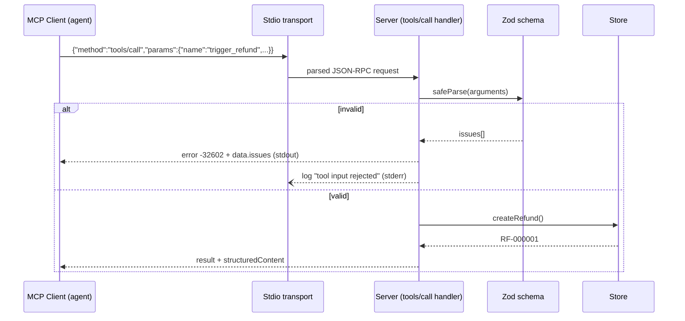

# RFC-001: Customer Support MCP Server with Strict Validation

> **Audience note:** sections 1, 2 and 8 read without a technical background. Section 9 goes deep.

**Author(s):** hurkanakbiyik
**Status:** In Review
**Created:** 2026-11-05
**Reviewers / Approvers:** Solution Architect assessment panel
**Decision:** pending review
**Related product spec:** [product-spec.md](product-spec.md)

---

## 1. Summary

We build a stdio MCP server in TypeScript on the official SDK with two tools. Zod schemas define each tool once: the same schema produces the JSON Schema in `tools/list` and validates every `tools/call`. Bad input gets JSON-RPC `-32602` with field-level details. We use the SDK's low-level `Server` class, because the high-level `McpServer` turns validation failures into ordinary tool results and the brief requires protocol errors.

## 2. Problem & Context

Agents send malformed arguments often: wrong id formats, negative amounts, placeholder reasons. The server must stop those calls before they touch billing, and tell the client exactly which field failed using standard JSON-RPC codes. Over stdio, any stray byte on stdout breaks framing for the client, so logging needs a hard boundary. See the product spec for the user impact.

## 3. Goals & Non-Goals

- **Technical goals:** one source of truth per tool schema; `-32602` with `data.issues` for every validation failure; `-32700`/`-32600`/`-32601` for envelope problems; stdout carries JSON-RPC only.
- **Non-goals:** auth, persistence, HTTP transport, output schemas.

## 4. Requirements

### 4.1 Functional Requirements

T1-FR-001 to T1-FR-010 from the product spec, unchanged. The sharpest technical one: **T1-FR-003**, when `safeParse` fails, the system shall throw `McpError(InvalidParams, msg, { issues })` and shall not call the tool handler.

### 4.2 Non-Functional Requirements

- 100% of stdout lines parse as JSON-RPC 2.0 under the full e2e suite.
- Validation cost under 1 ms per call.
- No runtime dependencies beyond `@modelcontextprotocol/sdk` 1.32.2 and `zod` 4.

### 4.3 Requirements From Other Teams

| Team | Requirement | Priority | Status |
|---|---|---|---|
| Gateway (Task 2) | Tool names stable; admin tools prefixed `admin_` | Must | Agreed |
| Security | No PII in logs | Must | Agreed |

## 5. Assumptions

- Clients speak MCP protocol version 2025-06-18 or later.
- `CUST-XXXXX` means five digits (spec section 10).
- The customer store stays in memory for this assessment.

## 6. Current Architecture (As-Is)

No server exists. While prototyping we checked SDK 1.32.2 behavior: `McpServer.registerTool` validates input, but its `tools/call` handler catches the `McpError` and returns `{ isError: true, content: [...] }` (see `node_modules/@modelcontextprotocol/sdk/dist/esm/server/mcp.js`, `createToolError`). We also found two SDK gaps: the stdio transport drops unparseable lines without a reply, and the protocol layer maps a non-object `arguments` to `-32603` Internal error.

## 7. Proposed Solutions

### Option A: High-level `McpServer` + `registerTool`

**Description:** register tools with Zod shapes and let the SDK validate.

**Pros:**
- Least code. SDK generates schemas and validates.

**Cons:**
- Validation failures come back as `isError` results, not `-32602`. Fails the brief.
- No control over `error.data`.

**Effort:** 0.5 day
**Risk:** High (non-compliant with requirements)

### Option B: Low-level `Server` + own handlers + Zod

**Description:** register `tools/list` and `tools/call` handlers ourselves. Generate JSON Schema with `z.toJSONSchema`, validate with `safeParse`, throw `McpError(-32602)`.

**Pros:**
- Exact error mapping and `data.issues`.
- Still uses the SDK for framing, lifecycle and the `initialize` handshake.

**Cons:**
- About 60 more lines than Option A. The SDK marks `Server` for "advanced use cases".

**Effort:** 1 day
**Risk:** Low

### Option C: Hand-rolled JSON-RPC over stdio, no SDK

**Pros:** total control.
**Cons:** violates "use the official SDK"; we would reimplement `initialize`, capabilities and cancellation.
**Effort:** 2 days. **Risk:** Medium.

### Comparison

| Approach | Pros | Cons | Effort | Risk |
|---|---|---|---|---|
| A: McpServer | least code | wrong error channel | 0.5 d | High |
| B: low-level Server | exact codes, SDK framing | slightly more code | 1 d | Low |
| C: no SDK | control | breaks brief, reinvents protocol | 2 d | Medium |

## 8. Recommendation

Option B. It is the only option that meets the error-code requirement while staying on the official SDK. We accept about 60 extra lines and a dependency on the low-level API, which the SDK still ships and documents.

## 9. Detailed Design (Recommended Option)

- **Data model changes:** none. In-memory `Map<customer_id, Customer>` and a refund list (`src/task1-mcp-server/store.ts`).
- **API changes / contracts:**
  - `get_customer_record { customer_id: /^CUST-\d{5}$/ }`
  - `trigger_refund { customer_id, amount: number > 0 finite, reason: trim, 10..1000 chars }`, `strictObject` (unknown keys rejected)
  - Validation error: `{ code: -32602, message: "MCP error -32602: Invalid arguments for <tool>", data: { issues: [{ path, message }] } }`
  - Unknown customer: result `{ isError: true }` (a tool execution error per MCP spec).
- **SDK gap fixes:**
  - `tools/call` registers a loose envelope schema (`params: looseObject`). The `Server` class wrapper then re-validates against `CallToolRequestSchema` and answers `-32602`, not `-32603`, for malformed `params`.
  - `createStdioTransport()` sets `onerror` before `connect()` and replies `-32700` (SyntaxError) or `-32600` (ZodError) with `id: null`.
- **stdout isolation:** a stderr JSON logger (`src/shared/log.ts`); `main.ts` rebinds `console.log/info/debug` to stderr as a guard against dependencies; a test scans the server source for stdout writes.
- **Detailed sequence diagram:**

- **Migration path:** none (new service).

## 10. Cross-Team Dependencies & Sign-off

| Team | What's needed from them | Status |
|---|---|---|
| Gateway (Task 2) | Forward `tools/call` errors unchanged | Signed off (tested) |

## 11. Open Questions

| Question | Owner | Needed by |
|---|---|---|
| Is X in `CUST-XXXXX` digit-only? | Product | Before Phase 2 |
| Follow MCP 2025-11-25 advice (validation errors as tool results)? | Architecture | Before Phase 2 |

## 12. Risks & Mitigations

| Risk | Likelihood | Impact | Mitigation |
|---|---|---|---|
| SDK upgrade changes `Server` validation wrapper | Medium | `-32603` returns for bad params | e2e test `rejects arguments that are not an object` pins it |
| A dependency prints to stdout | Low | Client framing breaks | console rebind in `main.ts` + purity test |
| Agents loop on `-32602` | Low | Token waste | `data.issues` names the field; eval `id_missing_prefix` checks recovery |

## 13. Rollout & Rollback Plan

- **Phase 1:** ship with mocks; run `npm test` and `npm run eval -- --only task1` in CI.
- **Phase 2:** swap the store for real adapters behind the same tool contracts.
- **Rollback:** clients pin the previous server binary; the tool contract has no migrations.

## 14. Appendix

- Requirement-to-test map: T1-FR-001/002/010 `lists both tools`; T1-FR-003/004 `validation maps to JSON-RPC -32602`; T1-FR-005 `rejects an unknown tool`; T1-FR-006/007 `JSON-RPC envelope errors`; T1-FR-008 `unknown customer`; T1-FR-009 `stdio isolation`.
- Evals: `evals/task1-mcp-server.eval.ts` (6 agent cases, Claude judge).
