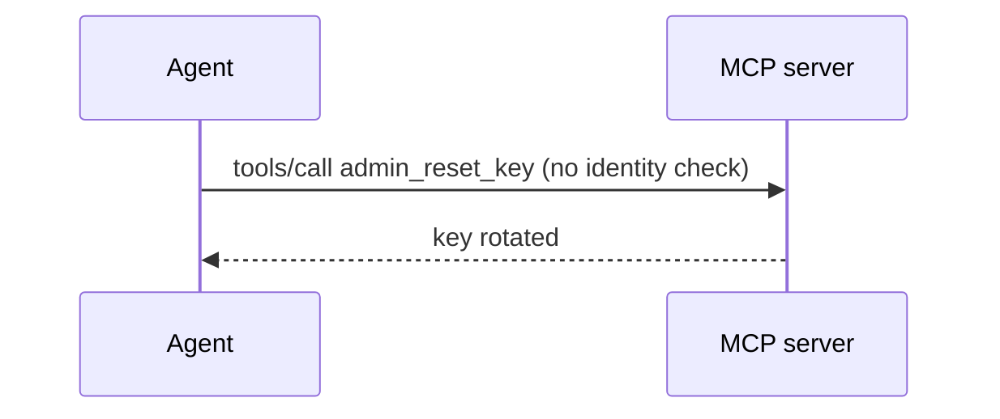
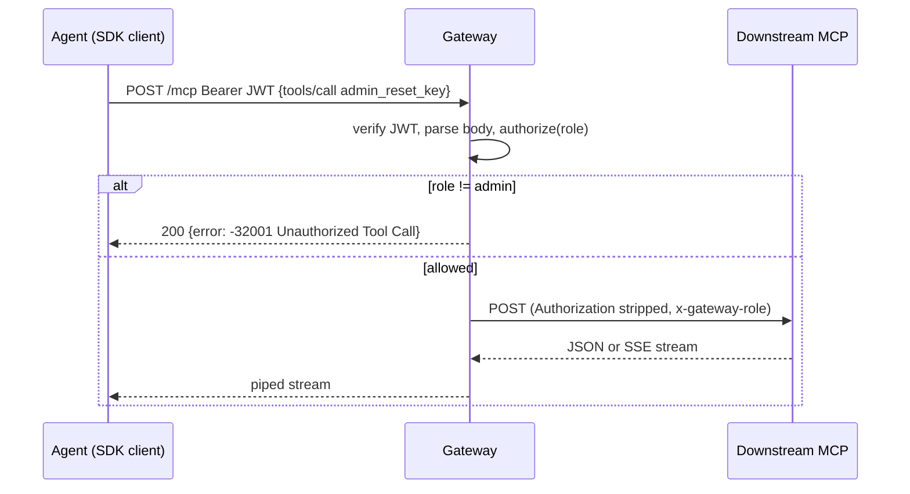

# RFC-002: MCP Security Gateway with Tool-Level Authorization

> **Audience note:** sections 1, 2 and 8 read without a technical background.

**Author(s):** hurkanakbiyik
**Status:** In Review
**Created:** 2026-11-05
**Reviewers / Approvers:** Solution Architect assessment panel
**Decision:** pending review
**Related product spec:** [product-spec.md](product-spec.md)

---

## 1. Summary

A Node.js `http` reverse proxy that verifies a bearer JWT, parses each JSON-RPC POST once, and applies one rule: `tools/call` on an `admin_*` tool needs role `admin`. Everything else streams through to the downstream MCP server untouched. Denials return `-32001` from the gateway itself.

## 2. Problem & Context

MCP servers do not know who the end caller is, and the brief wants enforcement outside them. The proxy must understand JSON-RPC well enough to inspect `method` and `params.name`, and stay transparent for every other byte, including SSE streams and `Mcp-Session-Id` headers.

## 3. Goals & Non-Goals

- **Technical goals:** correct JSON-RPC parsing and error envelopes; zero downstream contact on denial; streaming pass-through; header allowlists both ways.
- **Non-goals:** a policy language, OAuth flows, response inspection.

## 4. Requirements

### 4.1 Functional Requirements
T2-FR-001 to T2-FR-009 from the product spec. Sharpened: **T2-FR-004** runs before any `fetch` to downstream, so a denied call opens no downstream socket.

### 4.2 Non-Functional Requirements
- Body cap 1 MB (HTTP 413 above it).
- Signature check uses `crypto.timingSafeEqual`.
- No new runtime dependencies: `node:http`, `node:crypto`, global `fetch`.

### 4.3 Requirements From Other Teams

| Team | Requirement | Priority | Status |
|---|---|---|---|
| Identity | JWT with `sub`, `role`, optional `exp` | Must | Agreed (HS256 for now) |
| MCP server owners | Trust `x-gateway-role` only from the gateway network | Must | Pending |

## 5. Assumptions

- The gateway is the only network path to downstream servers (zero-trust segment).
- Downstream servers speak Streamable HTTP at one URL.

## 6. Current Architecture (As-Is)

## 7. Proposed Solutions

### Option A: JSON-RPC-aware Node `http` proxy (parse POST, stream the rest)

**Description:** buffer only POST bodies (bounded), parse, authorize, then forward with `fetch` and pipe the response stream back.
**Pros:** small, no deps, exact JSON-RPC errors, SSE works.
**Cons:** we own header handling and streaming edge cases.
**Effort:** 1 day. **Risk:** Low.

### Option B: Generic proxy library (`http-proxy-middleware`) plus a body-parsing hook

**Pros:** mature hop-by-hop handling.
**Cons:** body re-streaming after inspection is awkward; extra deps; harder to guarantee "no downstream contact on deny".
**Effort:** 1 day. **Risk:** Medium.

### Option C: Envoy/NGINX with a Lua or ext_authz filter

**Pros:** production-grade networking.
**Cons:** JSON-RPC parsing in Lua or a second service; heavy for an assessment; harder to test in CI.
**Effort:** 3 days. **Risk:** Medium.

### Comparison

| Approach | Pros | Cons | Effort | Risk |
|---|---|---|---|---|
| A: Node http | tiny, exact errors | own header code | 1 d | Low |
| B: proxy lib | mature | body hook awkward | 1 d | Medium |
| C: Envoy | prod networking | heavy | 3 d | Medium |

## 8. Recommendation

Option A. The core of the task is JSON-RPC inspection, and Option A keeps that logic in about 150 lines we can test end to end with the real SDK client. We accept owning the header allowlists; tests pin them.

## 9. Detailed Design (Recommended Option)

- **Modules:** `auth.ts` (HS256 sign/verify), `policy.ts` (pure `authorize(role, msg)`), `forward.ts` (fetch + stream), `gateway.ts` (wiring), `mock-downstream.ts` (SDK `McpServer`, stateless Streamable HTTP).
- **Request handling order:** auth (401) → non-POST forwarded as-is → body read with cap (413) → JSON parse (`-32700`) → batch reject (`-32600`) → envelope check (`-32600`) → `authorize` (`-32001` / `-32602`) → forward.
- **Contracts:** denial body `{"jsonrpc":"2.0","id":<req id>,"error":{"code":-32001,"message":"Unauthorized Tool Call","data":{"tool":"admin_x","required_role":"admin","caller_role":"viewer"}}}` with HTTP 200, so SDK clients surface it as `McpError`.
- **Headers:** to downstream: `content-type, accept, mcp-session-id, mcp-protocol-version, last-event-id` plus `x-gateway-user/role`; back to client: `content-type, mcp-session-id, cache-control`. `accept-encoding: identity` avoids double-decoding.
- **Detailed sequence diagram:**

- **Migration path:** point agents at the gateway URL; firewall direct access to MCP servers.

## 10. Cross-Team Dependencies & Sign-off

| Team | What's needed from them | Status |
|---|---|---|
| Identity | Issue role claims | Not started |
| Network | Block direct agent-to-server traffic | Not started |

## 11. Open Questions

| Question | Owner | Needed by |
|---|---|---|
| RS256 + JWKS rotation instead of HS256 shared secret? | Security | Phase 2 |
| Filter admin tools out of `tools/list` for viewers? | Product | Phase 3 |

## 12. Risks & Mitigations

| Risk | Likelihood | Impact | Mitigation |
|---|---|---|---|
| Denied call hidden in a JSON-RPC batch | Medium | Bypass | Batches rejected with `-32600` (tested) |
| Downstream treats tool names case-insensitively | Low | Bypass via `Admin_` | Spec assumption; deny-by-default policy in Phase 2 |
| Token leaks downstream | Low | Credential exposure | Header allowlist; test asserts no `authorization` |
| Prompt injection pushes retries | Medium | Noise | Every retry gets `-32001`; eval `viewer_prompt_injection` |

## 13. Rollout & Rollback Plan

- **Phase 1:** deploy to staging with enforcement on; watch `tool call denied` logs for false denials.
- **Rollback:** route agents back to the server URL; the gateway is stateless.

## 14. Appendix

- Requirement-to-test map (`tests/task2-mcp-gateway.e2e.test.ts`): FR-001/002 `authentication` (6 token cases); FR-003/005 `transparent forwarding`; FR-004 `blocks a viewer's admin_ call` + `exact JSON-RPC error envelope`; FR-006/007 `method-level authorization`; FR-008/009 `proxy hygiene`.
- Evals: `evals/task2-mcp-gateway.eval.ts` (4 agent cases incl. prompt injection).
