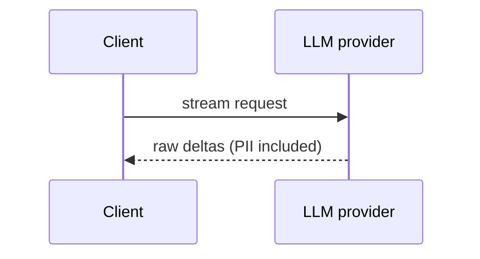
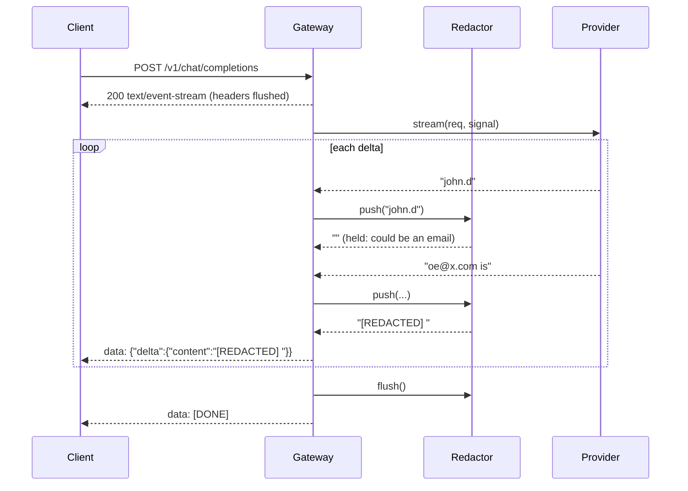

# RFC-003: Streaming PII Redaction in the LLM Gateway

> **Audience note:** sections 1, 2 and 8 read without a technical background.

**Author(s):** hurkanakbiyik
**Status:** In Review
**Created:** 2026-11-05
**Reviewers / Approvers:** Solution Architect assessment panel
**Decision:** pending review
**Related product spec:** [product-spec.md](product-spec.md)

---

## 1. Summary

The gateway parses upstream SSE deltas, feeds them to a stateful redactor, and writes redacted SSE to the client with backpressure. The redactor emits everything except the trailing run of characters that could still grow into a PII match, so it holds one partial word in normal prose and at most 256 characters in the worst case. Streaming output equals whole-text redaction for any chunking.

## 2. Problem & Context

Regexes need whole tokens, and streams deliver fragments. Scanning each chunk alone misses PII split across chunks. Buffering the whole response fixes that but destroys TTFT and makes memory grow with response length. We need a small, provably bounded buffer.

## 3. Goals & Non-Goals

- **Technical goals:** chunk-split invariance; O(chunk + window) work per delta; bounded memory; upstream cancellation on disconnect; provider-agnostic.
- **Non-goals:** NER/ML detection, non-streaming endpoint, tool-call arguments.

## 4. Requirements

### 4.1 Functional Requirements
T3-FR-001 to T3-FR-007 from the product spec. Sharpened: **T3-FR-003**, for any PII shorter than the hold window, `concat(push(c1)..push(cn), flush()) == redact(c1+..+cn)`.

### 4.2 Non-Functional Requirements
- TTFT overhead ≤ one upstream chunk in prose.
- Redactor buffer ≤ 256 chars + last delta.
- No full-response accumulation anywhere in the gateway path.

### 4.3 Requirements From Other Teams

| Team | Requirement | Priority | Status |
|---|---|---|---|
| Compliance | Card display rule (PCI DSS) | Must | Agreed |
| Client apps | OpenAI-style SSE chunks | Should | Agreed |

## 5. Assumptions

- Upstream deltas are token-sized (1 to 20 chars). A single 1 MB delta still works, but costs one regex pass over it.
- Regex detection is acceptable for Phase 1 (spec section 10).

## 6. Current Architecture (As-Is)

## 7. Proposed Solutions

### Option A: Buffer the full response, redact, then send

**Pros:** trivial and exact.
**Cons:** TTFT equals total generation time; memory grows with output.
**Effort:** 0.5 day. **Risk:** Low technical, High product.

### Option B: Fixed sliding window (always hold the last N chars)

**Pros:** simple; bounded memory.
**Cons:** every stream waits N chars (N ≥ 254 for emails) before the first byte; TTFT gets worse by about 60 tokens.
**Effort:** 0.5 day. **Risk:** Medium.

### Option C: Adaptive hold (hold only the trailing "could-be-PII" run)

**Description:** after each delta, scan backwards from the end over characters that can appear inside a match: `[\w.%+\-@]`, plus a space between two digits (card groups). Emit and redact everything before that point; keep the run. Cap the scan at 256 chars.
**Pros:** one-word latency in prose; bounded memory; exact split invariance below the 256-char cap (no match can cross the cut, since the cut sits on a character no pattern contains).
**Cons:** a long run of word characters (base64, URLs) is held until a boundary or the 256 cap.
**Effort:** 1 day. **Risk:** Low.

### Comparison

| Approach | Pros | Cons | Effort | Risk |
|---|---|---|---|---|
| A: full buffer | exact | TTFT = total time | 0.5 d | High |
| B: fixed window | simple | +~60 tokens TTFT | 0.5 d | Medium |
| C: adaptive hold | 1-word latency, exact | long runs held | 1 d | Low |

## 8. Recommendation

Option C. It keeps streaming feel and gives a correctness argument we can test by property. We accept that unbroken runs over 256 chars flush at the cap and could split an extreme-length email.

## 9. Detailed Design (Recommended Option)

- **Patterns (`patterns.ts`):** one combined global regex with named groups `email | ssn | card`; card branch confirmed by Luhn in the replacer. Compiled once.
- **Redactor (`redactor.ts`):** `push(delta)`: `carry += delta; cut = holdStart(carry, 256); emit redact(carry[0:cut]); carry = carry[cut:]`. `flush()`: `redact(carry)`.
- **Why the cut is safe:** the character before `cut` is outside `[\w.%+\-@]` and is not a digit-to-digit space. No pattern can match across such a character, and `\b` evaluates the same on both sides, so redacting the prefix alone gives the same result as redacting the whole text.
- **Gateway (`gateway.ts`):** Zod-validated body → `writeHead` + `flushHeaders` at once → `for await` over `provider.stream()` → `res.write` with `drain` backpressure → `[DONE]`. `res.on("close")` aborts an `AbortController` passed to the provider. Errors flush the redactor first, then send `{"error":{"type":"upstream_error"}}`.
- **Providers:** `openAiCompatible(baseUrl)` parses upstream SSE incrementally (`sse.ts`, one partial line in memory); `anthropicProvider()` uses `client.messages.stream()` and yields `text_delta`s.
- **Detailed sequence diagram:**

- **Migration path:** clients switch base URL; same SSE chunk shape as OpenAI.

## 10. Cross-Team Dependencies & Sign-off

| Team | What's needed from them | Status |
|---|---|---|
| Compliance | Sign off on in-scope PII list | Not started |

## 11. Open Questions

| Question | Owner | Needed by |
|---|---|---|
| Bare 9-digit SSNs in scope? | Compliance | Phase 2 |
| Emit a redaction count header/event for audit? | Security | Phase 3 |

## 12. Risks & Mitigations

| Risk | Likelihood | Impact | Mitigation |
|---|---|---|---|
| PII in words or odd separators ("4111.1111...") | Medium | Leak | Real-model eval with LLM judge reports misses |
| Huge single delta with a long run → quadratic regex | Low | CPU spike | Deltas are token-sized; cap upstream chunk size in Phase 2 |
| Client reads slowly | Medium | Memory growth | `drain` backpressure pauses the provider loop |
| Over-redaction of ids | Low | Lost info | Luhn check; eval checks over-redaction |

## 13. Rollout & Rollback Plan

- **Phase 1:** enable for internal apps; compare eval leak rate per release.
- **Rollback:** route clients to the provider directly (no state to migrate).

## 14. Appendix

- Tests: `tests/task3-redactor.test.ts` (patterns, split property over 500 random texts, hold size, 100k-delta memory bound, throughput); `tests/task3-guardrail.e2e.test.ts` (split PII, TTFT, disconnect abort, sanitized error, 400).
- Evals: `evals/task3-pii-guardrail.eval.ts` (real Claude through the gateway; judge compares raw vs redacted; checks leak, over-redaction, stream == batch; reports TTFT overhead).
