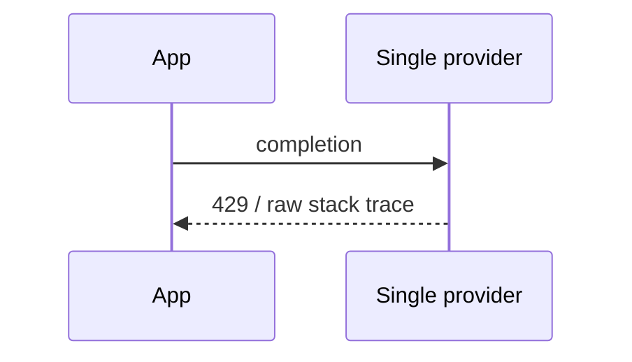
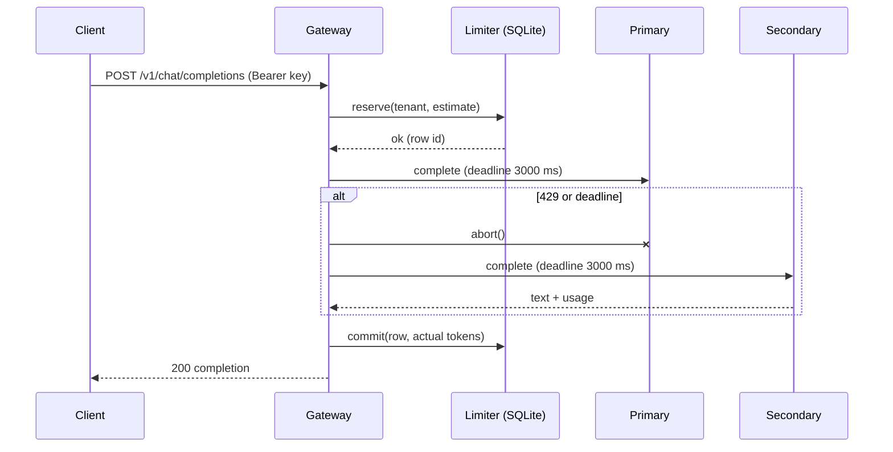

# RFC-004: Token-Aware Rate Limiter and Model Fallback Router

> **Audience note:** sections 1, 2 and 8 read without a technical background.

**Author(s):** hurkanakbiyik
**Status:** In Review
**Created:** 2026-11-05
**Reviewers / Approvers:** Solution Architect assessment panel
**Decision:** pending review
**Related product spec:** [product-spec.md](product-spec.md)

---

## 1. Summary

Each request reserves estimated tokens in a SQLite event log inside `BEGIN IMMEDIATE`, so concurrent requests cannot overshoot the 50k/min budget. A router races each provider call against a 3000 ms deadline, aborts the loser, and moves to the secondary only on 429 or timeout. A single error mapper turns every failure into a fixed, typed payload.

## 2. Problem & Context

Rate limiting by request count is wrong for LLMs: one request can cost 50 tokens or 30,000. Timeouts in Node are easy to get wrong: a `setTimeout` that rejects but does not abort leaves the primary running, and its late reply can race the secondary. Errors from providers carry internals that must not cross the gateway.

## 3. Goals & Non-Goals

- **Technical goals:** exact sliding window; atomic check-and-reserve; reconcile to real usage; hard 3000 ms deadline with cancellation; sanitized errors.
- **Non-goals:** distributed limiter, streaming, retries on the same provider.

## 4. Requirements

### 4.1 Functional Requirements
T4-FR-001 to T4-FR-011 from the product spec.

### 4.2 Non-Functional Requirements
- Reservation is one SQLite transaction: evict, sum, insert. Indexed on `(tenant, ts)` and `(ts)`.
- Deadline holds even if a provider adapter ignores its `AbortSignal`.

### 4.3 Requirements From Other Teams

| Team | Requirement | Priority | Status |
|---|---|---|---|
| Finance | Usage reflects provider-reported tokens | Should | Agreed |

## 5. Assumptions

- Gateway processes share one host and one SQLite file (WAL mode).
- Providers report `usage.total_tokens` (OpenAI shape) or input+output tokens (Claude).

## 6. Current Architecture (As-Is)

## 7. Proposed Solutions

### Option A: Fixed-window counter per minute (one row per tenant)

**Pros:** O(1) state. **Cons:** a tenant can spend 2x the limit across a minute boundary; `Retry-After` is coarse. **Effort:** 0.5 d. **Risk:** Medium.

### Option B: Sliding log in SQLite (one row per admitted request)

**Description:** usage = `SUM(tokens) WHERE tenant=? AND ts > now-60s`. Expired rows deleted on every reservation. `Retry-After` computed by walking rows oldest first until enough would expire.
**Pros:** exact; exact `Retry-After`; reconcile by updating one row. **Cons:** rows per tenant grow with request rate (bounded: at most 50k rows at 1 token each). **Effort:** 1 d. **Risk:** Low.

### Option C: Sliding-window counter approximation (two buckets, weighted)

**Pros:** O(1). **Cons:** approximate; reconcile is messy. **Effort:** 1 d. **Risk:** Medium.

### Comparison

| Approach | Pros | Cons | Effort | Risk |
|---|---|---|---|---|
| A: fixed window | tiny state | 2x burst at boundary | 0.5 d | Medium |
| B: sliding log | exact, exact Retry-After | more rows | 1 d | Low |
| C: weighted buckets | O(1) | approximate | 1 d | Medium |

## 8. Recommendation

Option B. Accuracy is a scored criterion, and SQLite handles thousands of rows per tenant with an index. We accept more rows than a counter and one SQL transaction per request.

## 9. Detailed Design (Recommended Option)

- **Data model:** `token_usage(id INTEGER PK, tenant TEXT, ts INTEGER ms, tokens INTEGER)`, indexes `(tenant, ts)` and `(ts)`. `PRAGMA journal_mode=WAL, busy_timeout=5000`.
- **Reserve:** `BEGIN IMMEDIATE` → `DELETE ts <= now-60s` → `SUM` → reject or `INSERT` → `COMMIT`. `node:sqlite` is synchronous, so no `await` can interleave inside the transaction; `IMMEDIATE` takes the write lock up front for other processes.
- **Reconcile:** success → `UPDATE tokens = actual`; failure → `DELETE` the row.
- **Deadline:** `callWithTimeout` = `Promise.race([provider.complete(req, signal), deadline])`. The deadline timer calls `abort()` and rejects with `UpstreamError("timeout")`. The losing promise gets a no-op `catch`. `clearTimeout` in `finally`. Client disconnect joins via `AbortSignal.any`.
- **Failover set:** `{"rate_limited", "timeout"}` only.
- **Errors:** `GatewayError(status, type, message)`. Mapping: 400 `invalid_request`, 401 `authentication_error`, 429 `rate_limit_exceeded` (+`Retry-After`), 503 `upstream_unavailable` (all 429/timeout), 502 `upstream_error`, 500 `internal_error`. Cause and stack go to stderr with `request_id`.
- **Detailed sequence diagram:**

- **Migration path:** new endpoint; tenants get keys via `TENANT_KEYS`.

## 10. Cross-Team Dependencies & Sign-off

| Team | What's needed from them | Status |
|---|---|---|
| Platform | Provide secondary provider credentials | Not started |

## 11. Open Questions

| Question | Owner | Needed by |
|---|---|---|
| Fail over on 5xx and connection errors too? | Architecture | Phase 2 |
| Charge tenants for timed-out primary work? | Finance | Phase 2 |

## 12. Risks & Mitigations

| Risk | Likelihood | Impact | Mitigation |
|---|---|---|---|
| Estimate too low for a long answer | Medium | Brief overshoot | Reserve `max_tokens` up front, reconcile after |
| Multi-host deployment | Medium | Per-host limits | Phase 3 shared store; same `reserve/commit/release` interface |
| Adapter ignores abort | Low | Socket leak | `Promise.race` still returns at deadline; test checks the mock saw the abort |
| Secondary also slow | Low | 6 s worst case | Per-attempt deadline; total budget in Phase 2 |

## 13. Rollout & Rollback Plan

- **Phase 1:** deploy with generous limits; watch `rate_limit_exceeded` rate.
- **Rollback:** point clients back at the provider; delete the SQLite file.

## 14. Appendix

- Tests: `tests/task4-rate-limiter.test.ts` (fake clock: limit edge, slide at exact ms, eviction, isolation, commit/release, disk persistence); `tests/task4-router.e2e.test.ts` (429 failover, 3000 ms timeout + abort, no failover on 500, sanitized 502/503, 20-way concurrency, 401/400).
- Evals: `evals/task4-router.eval.ts` (planted secrets in upstream errors, judge for leaks and actionability, judge calibration, real fallback to Claude).
