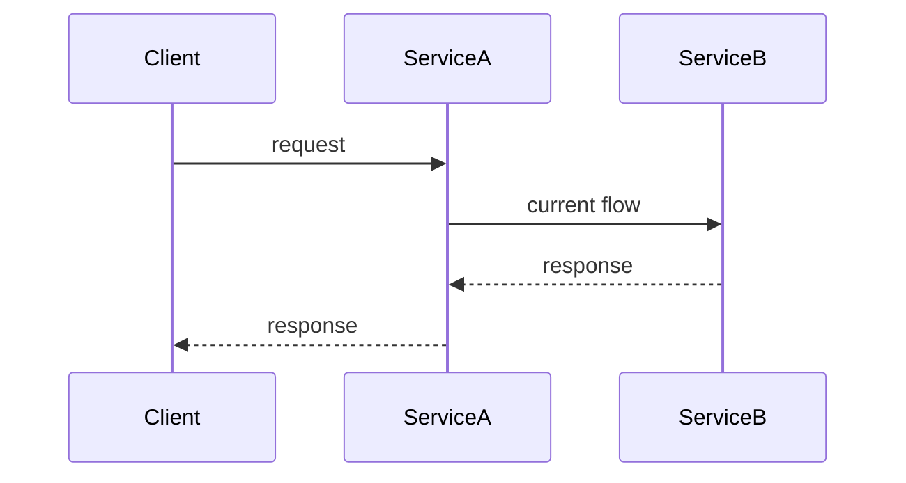
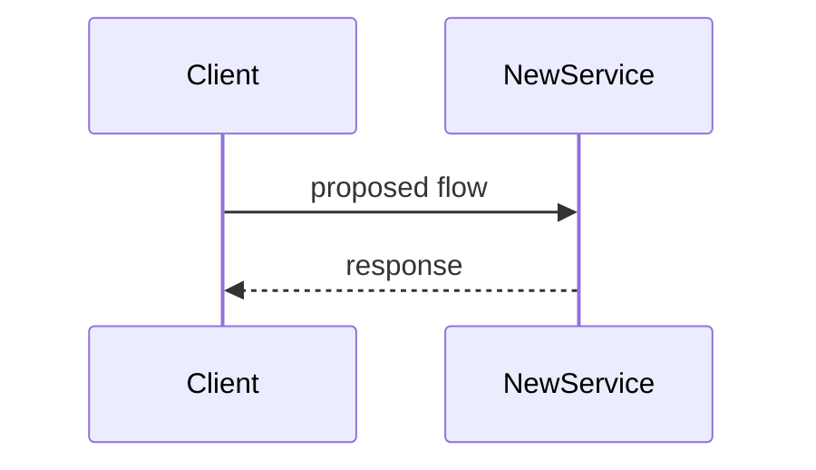
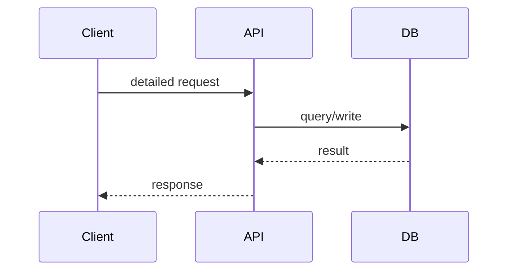

# RFC-[NNN]: [Title]

> **Audience note:** this doc goes to both engineering and product. Keep the Summary, Problem, and Recommendation sections readable without a technical background. Detailed Design can go as deep as it needs to.

**Author(s):**
**Status:** Draft / In Review / Accepted / Rejected / Superseded
**Created:**
**Reviewers / Approvers:**
**Decision:** [filled in after review — accepted option + date]
**Related product spec:** [link]

---

## 1. Summary

One paragraph. What's being proposed, and why. A reviewer who reads only this should understand the shape of the decision being asked of them.

## 2. Problem & Context

Restate the problem from the product spec in technical terms. Why does it need solving now? Link back to the product spec rather than repeating its evidence section here.

## 3. Goals & Non-Goals

- **Technical goals:** what this design has to achieve
- **Non-goals:** what it's explicitly not trying to solve — keeps the comparison in section 5 honest

## 4. Requirements

### 4.1 Functional Requirements
Carried over from the product spec, restated where the technical framing sharpens them.

- **FR-001:** When [trigger], the system shall [response].
- **FR-002:**

### 4.2 Non-Functional Requirements
Performance, security, compliance, scale, availability. Numbers, not adjectives.

### 4.3 Requirements From Other Teams

| Team | Requirement | Priority | Status |
|---|---|---|---|
| | | Must / Should | Agreed / Pending |
| | | | |

## 5. Assumptions

What's being taken as given about existing systems, data, or timing. State it so it can be challenged.

## 6. Current Architecture (As-Is)

Brief description, plus a diagram if the current flow matters to understanding the problem.

*Diagram source (if drawio): [link to editable .drawio file]*

## 7. Proposed Solutions

Describe each candidate independently before comparing them. Add or remove options as needed — two is a minimum, not a target.

### Option A: [Name]

**Description:**

**Diagram:**

*Or, for a more complex architecture:  — [editable source](link-to-drawio)*

**Pros:**
-

**Cons:**
-

**Effort:** [rough estimate]
**Risk:** Low / Medium / High

### Option B: [Name]

**Description:**

**Diagram:**

**Pros:**
-

**Cons:**
-

**Effort:**
**Risk:**

### Option C: [Name] *(add more as needed)*

---

### Comparison

| Approach | Pros | Cons | Effort | Risk |
|---|---|---|---|---|
| Option A | | | | |
| Option B | | | | |
| Option C | | | | |

## 8. Recommendation

Which option, and why. Name the trade-offs being accepted, not just the ones avoided — a reviewer trusts a recommendation more when it admits what it costs.

## 9. Detailed Design (Recommended Option)

- **Data model changes:**
- **API changes / contracts:**
- **Detailed sequence diagram:**

- **Migration path:**

## 10. Cross-Team Dependencies & Sign-off

| Team | What's needed from them | Status |
|---|---|---|
| | | Not started / In progress / Signed off |

## 11. Open Questions

Things that need an answer before or during build. Give each one an owner so it doesn't sit unresolved.

| Question | Owner | Needed by |
|---|---|---|
| | | |

## 12. Risks & Mitigations

| Risk | Likelihood | Impact | Mitigation |
|---|---|---|---|
| | | | |

## 13. Rollout & Rollback Plan

- **Phase 1:** [scope] — [timeline]
- **Phase 2:** [scope] — [timeline]
- **Rollback:** how to revert if this goes wrong in production

## 14. Appendix

- Diagram sources: [links to .drawio files, Mermaid Live Editor links if useful for editing]
- Further reading / prior art:
